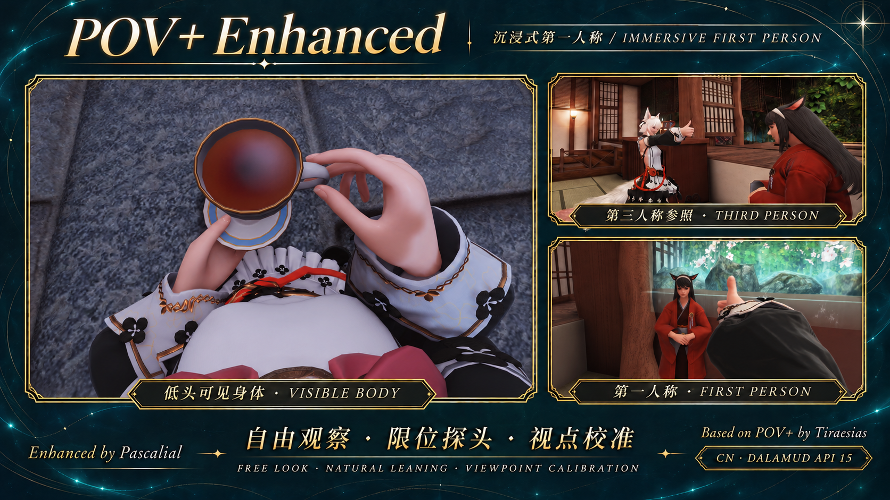

# POV+ Enhanced



[中文 / English](README.md) · **English**

See your body, turn and lean naturally, and keep your head's shadow.

A community fork of [Tiraesias's POV+](https://github.com/TiraesiascenGraven/POVPlus) Beta for FFXIV CN / Dalamud. Current version: **1.6.1.2**. Original attribution, Git history and the AGPL-3.0-or-later license are retained.

## Installation

1. Open Dalamud Settings → **Experimental** → **Custom Plugin Repositories**. Add, enable and save:

   ```text
   https://raw.githubusercontent.com/pascalial98-hue/POVPlus/main/repo.json
   ```

2. Refresh the plugin installer, search for **POV+ Enhanced**, and install it. Future updates use the same installer; the testing channel is not required.
3. In Character Configuration → Control Settings → General, set **1st Person Camera Auto Adjustment** to **Never**.
4. On first use, calibration opens automatically in third person. Use the front/side character diagrams to align the cyan viewpoint marker with the surface of the nose bridge between the eyes. Save, then enter first person with the normal game controls.
5. Reopen **Viewpoint calibration** at the top of `/pov` anytime during normal gameplay, outside combat.

**Migrating from upstream or a personal test build:** back up your `PovPlus` configuration, disable the old plugin, and remove its development-plugin entry if present. Disable the original POV+ custom repository before installing this fork. The internal name remains `PovPlus` to preserve settings. Do not load two copies at once; deleting your configuration is normally unnecessary.

Manual packages are available in [Releases](https://github.com/pascalial98-hue/POVPlus/releases/latest). The custom repository is recommended for normal installation. `PovPlus.Enhanced.zip` in the repository root is the current installer package; the other old ZIPs and `SamplePlugin` are inherited upstream files, not current fork releases.

## Features

| Feature | Behavior |
| --- | --- |
| First-use guide | A movable window, FFXIV character front/side diagrams, live viewpoint marker and three-axis fine adjustment. Save to apply; closing or cancelling discards draft offsets. |
| Head hiding and camera transitions | Hides the head as the camera approaches, and restores it only after the camera has moved away. Enabled by default for new configurations. |
| Complete head shadow, on by default | Excludes face, hair, headgear and related models from the main view while keeping their native shadow rendering. No duplicate actor is created. |
| Natural look limits | Separate horizontal, upward and downward limits with gentle slowdown near the boundary. |
| Lean beyond the boundary | Continue moving the mouse at a limit to lean forward or sideways. Adjustable distance, sensitivity and extra angle; translation and rotation blend together. Holds when input stops, retracts with reverse input. |
| Direct mouse look, optional | Turn without holding RMB; hold LMB to look around without turning the character. Release the cursor with a customizable held or toggled key/chord. |
| Stationary-pose protection | Ordinary RMB and direct mouse look preserve sitting, dozing and similar looped poses. Movement keys still end the pose. |
| Head-animation weights | Independent 0–100% yaw, pitch and roll weights, separate from smoothing. |
| Close-up visibility | NearPlane defaults to 0.015 for new configurations and supports values down to 0.001; optional near-object visibility, selected hair/ear details and attenuation of nearby self-targeted effects. |
| Bilingual settings | New configurations default to **中英对照 / 中文 + English**, pairing each Chinese item with English. **Auto / 简体中文 / English** remain available at the top of settings. Changes apply immediately. Auto follows Dalamud's UI language, using English for non-Chinese languages. |

Use `/pov toggle` to enable or disable the plugin. Ordinary settings save automatically; calibration offsets require **Save and finish**. Existing configurations are not interrupted with automatic onboarding, and their offsets and NearPlane remain unchanged. Head hiding and full head shadows default to on for new configurations. Existing choices, including language selections, are retained. Full head shadows remain experimental and can be disabled; near-object visibility, appearance details and self-effect attenuation still default to off.

## Compatibility and limitations

- Latest validation baseline: **CN client `2026.11.03.0000.0000`, Dalamud API 15 (15.0.4.0), Windows x64 / .NET 10**. Starting with 1.6.0.1, the exact game-date restriction is removed, so ordinary updates are not rejected solely because their date changed. API requirements and existing native-interface checks remain. This does not guarantee compatibility with every future build; API or native-interface changes still require adaptation. **International clients remain unverified.**
- NearPlane 0.001 retains more close-up clothing but can make mist and other particles appear through terrain. This tradeoff remains configurable; increasing NearPlane can improve particle occlusion.
- Complete head shadows require the game's self-shadow option. This mode hides entire head-related models, so hair tips/ear accessories cannot be selectively retained; neck geometry belonging to the face model may also disappear. Unusual mods may use different model slots.
- Near-object visibility affects only the relevant distance-based visibility check, not every static map object, backface-culling case or unloaded resource.
- Pose protection recognizes fixed/looped game states; it does not promise to protect every short emote, cast, mount state or custom animation. Cursor hotkeys still reach the game, so avoid binding conflicts.
- Core features received in-game feedback during development. Version 1.6.1.0 passed compilation, offline regressions and calibration-camera field-layout checks. The new guide, illustration layout and actual viewpoint alignment still need in-game verification.

## Source and feedback

Buildable current source is in [`src/`](src), with offline regressions in [`tests/`](tests). This fork starts from source recovered from the author's published Beta binary, with subsequent modifications. The older upstream `SamplePlugin` folder is retained for historical reference only.

See the [bilingual build guide](docs/BUILD.md) and [changelog](CHANGELOG.md). Report problems in [this fork's Issues](https://github.com/pascalial98-hue/POVPlus/issues), including game/Dalamud/plugin versions, relevant options, reproduction steps and necessary logs. Remove personal information from logs first.

Thanks to **Tiraesias / TiraesiascenGraven**, and to the Hypostasis, Dalamud and FFXIVClientStructs projects used by the original plugin. See [NOTICE](NOTICE.md) and [LICENSE](LICENSE.md). This fork is independently maintained.
