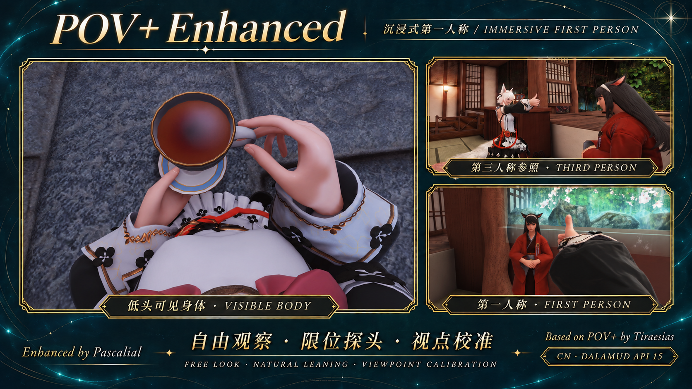

# POV+ Enhanced

**中文 / English · 1.6.1.3** · [English only](README.en.md)

基于 Tiraesias 的 POV+ Beta 制作的国服第一人称增强分支。 
An immersive first-person camera for FFXIV CN, built on Tiraesias's POV+ Beta.

低头看见自己的身体和衣服，自然地观察、探头，并把视点调整到适合自己角色的位置。 
Look down to see your body and clothes, look around naturally, and adjust the viewpoint to your own character.

当前面向国服 / Dalamud API 15。最近编译基线：国服 2026.11.03.0000.0000 / Dalamud 15.0.4.0。国际服尚未验证。 
CURRENT TARGET: Chinese client, Dalamud API 15. Latest build baseline: CN 2026.11.03.0000.0000 / Dalamud 15.0.4.0. International clients have not been verified.

## 功能 / Features

- 第一人称显示身体，默认隐藏自己的头部并保留完整头影；镜头接近头部后才隐藏，切回第三人称、离开头部后再恢复。 
  Visible body in first person. Head hiding and full head shadows are enabled by default; the head disappears as the camera approaches and returns after it moves away.

- 左右、抬头、低头范围分别可调，接近边界时柔和减速。 
  Adjustable horizontal and vertical look limits, with gentle slowdown near the edge.

- 顶到转头限位后继续拖动可前伸或侧伸；距离、灵敏度与额外转角可调，停止输入保持，反向拖动收回。 
  Lean forward or sideways by continuing to move the mouse at a look limit. Distance, sensitivity and extra viewing angle are adjustable. Lean holds when input stops and retracts with reverse input.

- 可选鼠标直控。按住左键自由观察，不带动人物转身；自定义按住或按下切换的快捷键呼出鼠标。 
  Optional direct mouse look. Hold the left mouse button to look around without turning your character; use a configurable held or toggled shortcut to release the cursor.

- 手柄右摇杆、普通右键和鼠标直控转镜头均保护坐下、躺下等固定循环动作；左摇杆和移动键仍可正常结束动作。 
  Gamepad right-stick look, ordinary right-drag and direct mouse look preserve sitting, dozing and similar fixed/looped poses. The left stick and movement keys still end the pose normally.

- 首次使用提供正侧面图示、实时视点标记和微调引导；正常场景、非战斗状态下，可从 /pov 顶部重新进入。 
  First-use calibration with front/side diagrams, a live viewpoint marker and fine adjustment. Reopen it from /pov anytime outside combat during normal gameplay.

- 左右、上下、侧倾分别设置跟随关联度；另有可选近物体保留和近处自身特效减弱。 
  Independent yaw, pitch and roll follow weights, plus optional nearby object visibility and attenuation of close self-effects.

- 新配置默认中英对照：每项中文后紧接英文。也可选择自动、简体中文或 English；旧配置保留语言选择，可在 /pov 顶部切换为“中英对照”。 
  New configurations show Chinese followed by English for each item. Auto, Chinese-only and English-only modes remain available. Existing language selections are retained; select the bilingual option at the top of /pov to switch.

## 安装 / Installation

需要启用了 Dalamud 的 XIVLauncherCN。 
Requires XIVLauncherCN with Dalamud enabled.

1. 输入 /xlsettings，进入“实验性 → 自定义插件仓库”。 
   Open /xlsettings → Experimental → Custom Plugin Repositories.

2. 添加以下地址，勾选启用并保存： 
   Add and enable this repository, then save:

   <https://raw.githubusercontent.com/pascalial98-hue/POVPlus/main/repo.json>

3. 输入 /xlplugins，刷新列表，搜索并安装 POV+ Enhanced。 
   Open /xlplugins, refresh, and install POV+ Enhanced.

4. 在“角色设置 → 操作设置 → 常规”中，将“第一人称视角自动调整”设为“从不 / Never”。 
   In Character Configuration → Control Settings → General, set 1st Person Camera Auto Adjustment to Never.

5. 按首次引导，将青色视点标记调到两眼之间的鼻梁表面；从正面和侧面各确认一次，保存后用游戏原有方式进入第一人称。 
   Follow the calibration guide: align the cyan marker to the surface of the nose bridge between the eyes, checking from both front and side. Save, then enter first person with the normal game controls.

/pov 打开设置；/pov toggle 切换启用状态。 
/pov opens settings. /pov toggle enables or disables the plugin.

已经添加本仓库的用户直接在安装器更新即可，已有设置保留。从原版或开发测试版迁移时，先停用旧插件及旧仓库/开发入口，保留 PovPlus 配置，不要同时加载两份。 
Already using this repository? Update through the installer; your settings are retained. If switching from the original POV+ or a development build, disable that copy and its old repository/development entry first. Keep your PovPlus configuration; do not load two copies together.

## 说明 / Notes

- 新配置 NearPlane 默认 0.015，旧值保留，仍可手动设置 0.001。过低时，水雾等粒子可能透过地形显示。 
  New configurations default to NearPlane 0.015. Existing values are retained; 0.001 remains available. Very low values can cause mist/particles to show through terrain.

- 新配置默认开启隐藏头部与完整头影，已有配置保留手动选择。完整头影仍为可关闭的试验项，需要游戏启用自身阴影；主画面整块隐藏对应头部模型，属于脸部模型的部分颈部也可能被隐藏。近物体保留、发梢/耳部细节及自身特效减弱仍默认关闭。 
  Head hiding and full head shadows default to on for new configurations; saved choices are retained. Full head shadows remain an experiment you can disable. Enable your own character shadows in the game; complete head-related models are hidden in the main view, including neck geometry belonging to the face model. Near-object visibility, hair/ear details and self-effect attenuation still default to off.

- 服装、脸型和动作模组会影响遮挡及对齐。插件沿用角色现有动作，不另附第一人称动作套组；预览中的外观模组不包含在插件中。 
  Outfit, face and animation mods can affect clipping and alignment. The plugin uses your character's existing animations; it does not supply a separate first-person animation set. The cosmetic mods shown in the preview are not included.

- 固定姿势保护覆盖相应循环状态，不保证每个动作都适用；近物体保留也不覆盖所有地图静态模型或尚未加载的物体。 
  Fixed-pose protection covers the relevant looped game states, not every emote or custom animation. Near-object visibility does not cover every static map model or unloaded object.

- 核心功能已在开发过程中获得游戏内反馈。新增校准与中英对照界面经过离线检查，实际游戏表现仍需确认；没有宣称已验证全部种族、改模或未来版本。 
  Core features received in-game feedback during development. The new calibration and paired bilingual interface are checked offline but still need in-game confirmation; not every race, mod or future client build has been verified.

## 署名与源码 / Credits & Source

原项目：Tiraesias / TiraesiascenGraven 
Original POV+: Tiraesias / TiraesiascenGraven

<https://github.com/TiraesiascenGraven/POVPlus>

增强分支：Pascalial / pascalial98-hue 
Enhanced fork: Pascalial / pascalial98-hue

<https://github.com/pascalial98-hue/POVPlus>

分支以原作者公开的 Beta 二进制恢复源码为基线。保留原署名及 AGPL-3.0-or-later 许可，发布包附完整对应源码和构建说明。感谢 Dalamud、FFXIVClientStructs 与 Hypostasis 项目。 
The fork's source baseline was recovered from the author's public Beta binary. Original attribution and the AGPL-3.0-or-later license are retained. Full corresponding source and build instructions are included with releases. Thanks to the Dalamud, FFXIVClientStructs and Hypostasis projects.

下载及更新记录：https://github.com/pascalial98-hue/POVPlus/releases/latest 
Downloads and changelog: https://github.com/pascalial98-hue/POVPlus/releases/latest

问题反馈：https://github.com/pascalial98-hue/POVPlus/issues 
Bug reports: https://github.com/pascalial98-hue/POVPlus/issues

反馈时请附插件、游戏及 Dalamud 版本，相关设置和复现步骤。 
Please include plugin, game and Dalamud versions, relevant settings and reproduction steps.

## 开发 / Development

当前可构建源码在 [`src/`](src)，离线回归在 [`tests/`](tests)。参阅[构建说明](docs/BUILD.md)、[更新记录](CHANGELOG.md)及[验证记录](docs/VALIDATION.md)。 
Buildable source is in [`src/`](src), with offline regressions in [`tests/`](tests). See the [build guide](docs/BUILD.md), [changelog](CHANGELOG.md) and [validation record](docs/VALIDATION.md).

根目录 `PovPlus.Enhanced.zip` 为当前安装包；其他旧 ZIP 和 `SamplePlugin` 保留自上游，非本分支当前发布内容。 
The root `PovPlus.Enhanced.zip` is the current installer package. Other old ZIPs and `SamplePlugin` are inherited upstream files, not current fork releases.

本分支保留原署名、Git 历史及 AGPL-3.0-or-later 许可。参阅 [NOTICE](NOTICE.md) 和 [LICENSE](LICENSE.md)。 
Original attribution, Git history and the AGPL-3.0-or-later license are retained. See [NOTICE](NOTICE.md) and [LICENSE](LICENSE.md).
